# Détection et classification des tumeurs cérébrales sur des images IRM avec YOLO

**Imagerie médicale · Vision par ordinateur · Détection d'objets · Apprentissage profond**

[](https://www.python.org/) [](https://pytorch.org/) [](https://docs.ultralytics.com/fr/) 

Ce projet académique porte sur **la détection, la localisation et la classification de tumeurs cérébrales à partir d'images d'imagerie par résonance magnétique (IRM)**. Il repose sur l'entraînement et la comparaison de plusieurs architectures **YOLOv8** et **YOLO12**, capables de produire des **boîtes englobantes**, des **étiquettes de classe** et des **scores de confiance**.

> **Périmètre de cette publication :** le seul code d'apprentissage publié est **le notebook d'entraînement original du projet**. Les méthodes de préparation des données et les résultats des tests sont documentés mais leurs scripts ne sont pas inclus. **Il s'agit d'un travail expérimental, non d'un dispositif médical.**

## 1. Aperçu des résultats visuels

| Prédictions avec YOLOv8x | Prédictions avec YOLO12l |
|:--:|:--:|
| 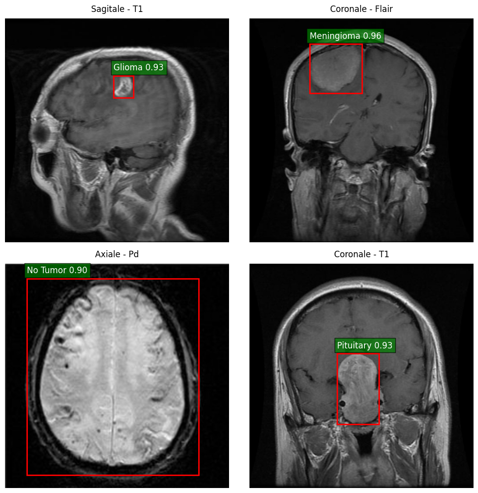 | 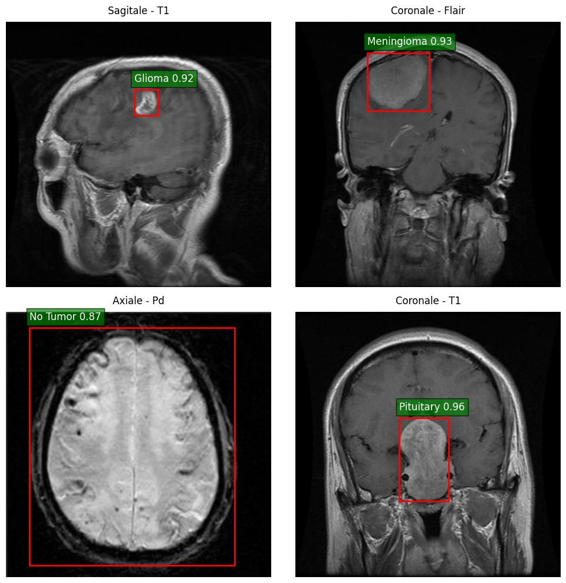 |

*Exemples de détections et de classifications sur différentes vues d'IRM.*

## 2. Objectifs du projet

- **Détecter** des régions d'intérêt sur les IRM cérébrales à l'aide de boîtes englobantes.
- **Identifier** les catégories du jeu de données : `Glioma`, `Meningioma`, `No Tumor` et `Pituitary`.
- **Comparer** plusieurs configurations des familles YOLOv8 et YOLO12 selon la précision, le rappel, le score F1 et les métriques mAP.
- **Analyser** les performances par classe, les courbes d'apprentissage, les meilleures époques et les limites de la détection sur des images de qualité variable.

Les sept architectures comparées sont **YOLOv8n, YOLOv8s, YOLOv8l, YOLOv8x, YOLO12n, YOLO12s et YOLO12l**. Une analyse plus détaillée a été réalisée pour **YOLOv8x et YOLO12l**.

## 3. Jeu de données et méthodologie

**Source :** [MRI for Brain Tumor with Bounding Boxes — Ahmed Sorour (Kaggle)](https://www.kaggle.com/datasets/ahmedsorour1/mri-for-brain-tumor-with-bounding-boxes).

Le jeu de données contient des images IRM annotées au **format YOLO**, avec des coordonnées de boîtes englobantes normalisées. Il couvre différentes orientations anatomiques (axiale, sagittale et coronale).

| Étape | Description d'après le rapport |
|---|---|
| Organisation | Regroupement des images et des annotations par partition dans une structure compatible avec YOLO |
| Répartition | **4 737** images d'entraînement, **255** de validation finale et **254** de test, sous réserve de l'écart d'effectifs signalé en section 7 |
| Prétraitement | Réorganisation et redimensionnement documenté à **640 × 640 pixels**, normalisation et augmentations pendant l'entraînement |
| Entraînement | Fine-tuning de modèles YOLO préentraînés, série de comparaisons sur **100 époques** |
| Évaluation | Précision, rappel, score F1, mAP@50, mAP@50:95, courbes de pertes et matrices de confusion |

### Chaîne de traitement

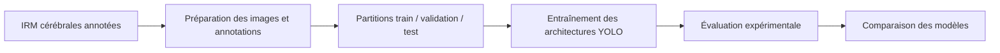

## 4. Résultats expérimentaux

Les scores ci-dessous correspondent aux résultats des expériences entraînées pendant **100 époques**, avec sélection d'un point de sauvegarde optimal (*best epoch*).

| Modèle | Précision | Rappel | Score F1 | mAP@50 | mAP@50:95 |
|:--|--:|--:|--:|--:|--:|
| YOLOv8n | 0,961 | **0,953** | 0,956 | **0,968** | 0,822 |
| YOLOv8s | 0,972 | 0,932 | 0,950 | 0,964 | 0,819 |
| YOLOv8l | 0,964 | 0,940 | 0,951 | 0,964 | 0,812 |
| YOLOv8x | 0,963 | 0,946 | 0,954 | 0,965 | 0,812 |
| YOLO12n | **0,975** | 0,950 | **0,962** | **0,968** | 0,818 |
| YOLO12s | 0,964 | 0,948 | 0,956 | 0,967 | **0,824** |
| YOLO12l | **0,975** | 0,933 | 0,954 | 0,964 | 0,818 |


**Principaux constats :** YOLO12s obtient la meilleure mAP@50:95 (**0,824**), YOLO12n le meilleur F1-score (**0,962**) et YOLOv8n le rappel le plus élevé (**0,953**). Aucun modèle ne domine l'ensemble des métriques.

### Comparaison ciblée : YOLOv8x et YOLO12l

| Métrique | YOLOv8x | YOLO12l |
|---|---:|---:|
| Précision | 0,963 | **0,975** |
| Rappel | **0,946** | 0,933 |
| Score F1 | 0,954 | 0,954 |
| mAP@50 | **0,965** | 0,964 |
| mAP@50:95 | 0,812 | **0,818** |

### Performances selon les catégories

Sur les évaluations historiques, les catégories **Glioma** et **Pituitary** ont des rappels plus faibles que les autres catégories : respectivement **0,919** et **0,892** pour YOLOv8x, contre **0,892** et **0,876** pour YOLO12l. Dans un contexte médical, l'examen des faux négatifs est donc particulièrement important.

## 5. Courbes d'entraînement et meilleures époques

### 5.1 Époques retenues pour les modèles étudiés en détail

Les courbes ci-dessous représentent les métriques de **validation** autour des meilleures époques. Les scores du tableau précédent sont issus des évaluations sur le **jeu de test** : les deux jeux de valeurs ne doivent pas être confondus.

| Modèle | Époques d'entraînement | Meilleure époque de validation | mAP@50:95 à cette époque (validation) | mAP@50:95 sur le test |
|---|---:|---:|---:|---:|
| YOLOv8x | 100 | **98** | 0,805 | 0,812 |
| YOLO12l | 100 | **89** | 0,806 | 0,818 |

| Évolution de YOLOv8x autour de la meilleure époque | Évolution de YOLO12l autour de la meilleure époque |
|:--:|:--:|
| 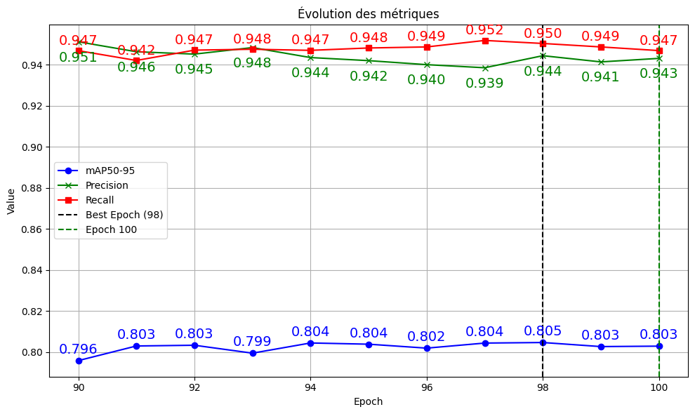 | 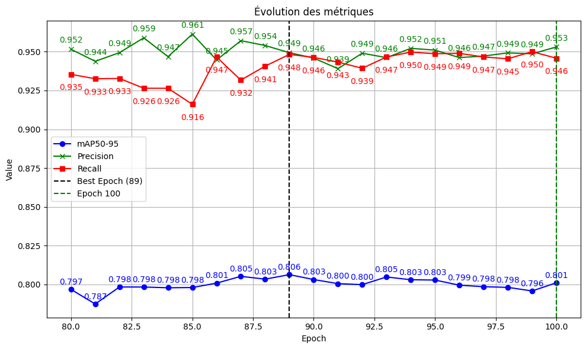 |


### 5.2 Évolution des métriques et des pertes

| Courbes de YOLOv8x | Courbes de YOLO12l |
|:--:|:--:|
| 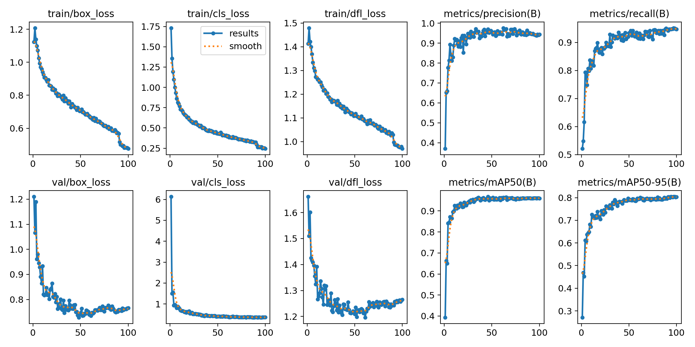 | 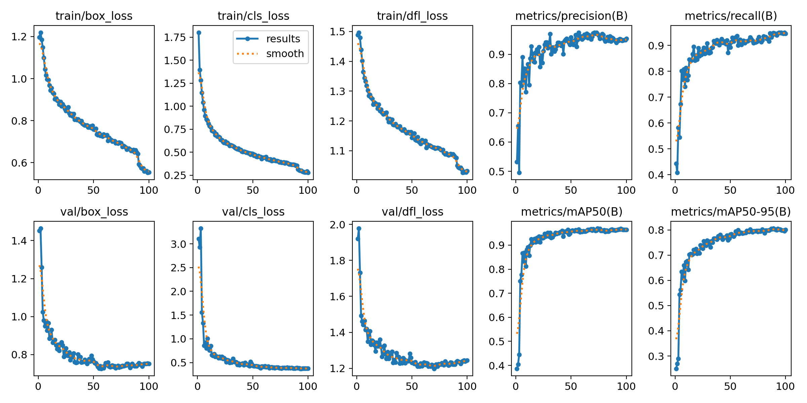 |

Ces graphes retracent l'évolution des **pertes de localisation (`box_loss`)**, de **classification (`cls_loss`)**, de **distribution (`dfl_loss`)**, ainsi que de la précision, du rappel et des métriques mAP lors de l'entraînement et de la validation.

### 5.3 Matrice de confusion et courbe précision-rappel

### Matrice de confusion normalisée 
| Matrice de confusion normalisée — YOLO12l | Matrice de confusion normalisée YOLOv8x |
|:--:|:--:|
| 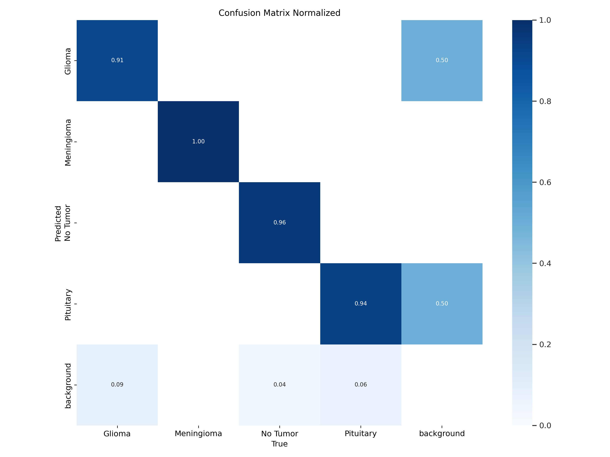 | 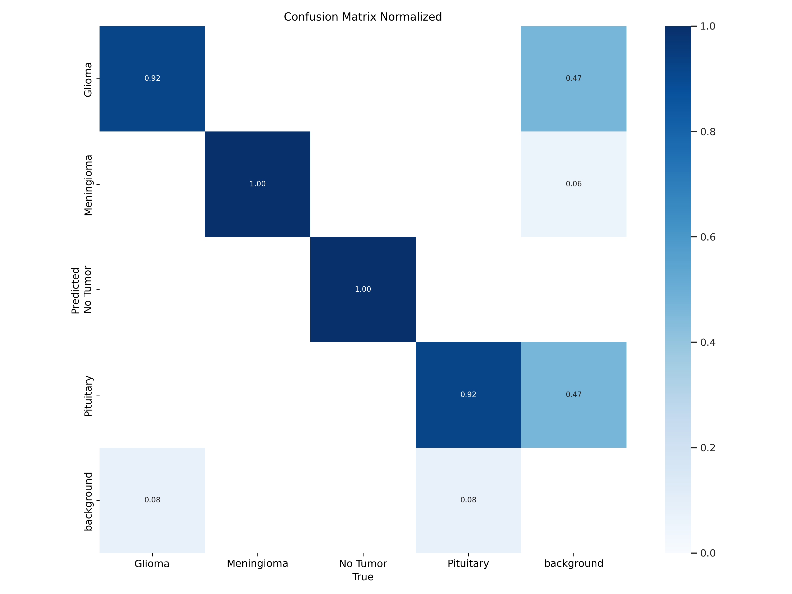 |


### Courbes précision-rappel (PR Curve)

| Courbe précision-rappel — YOLO12l | Courbe précision-rappel — YOLOv8x |
|:--:|:--:|
| 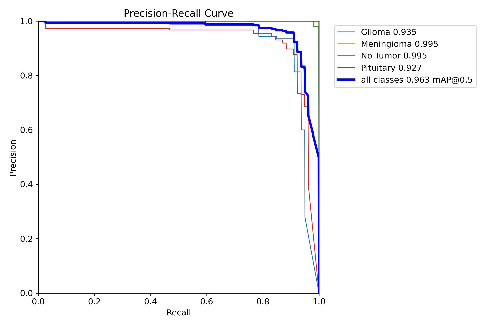 | 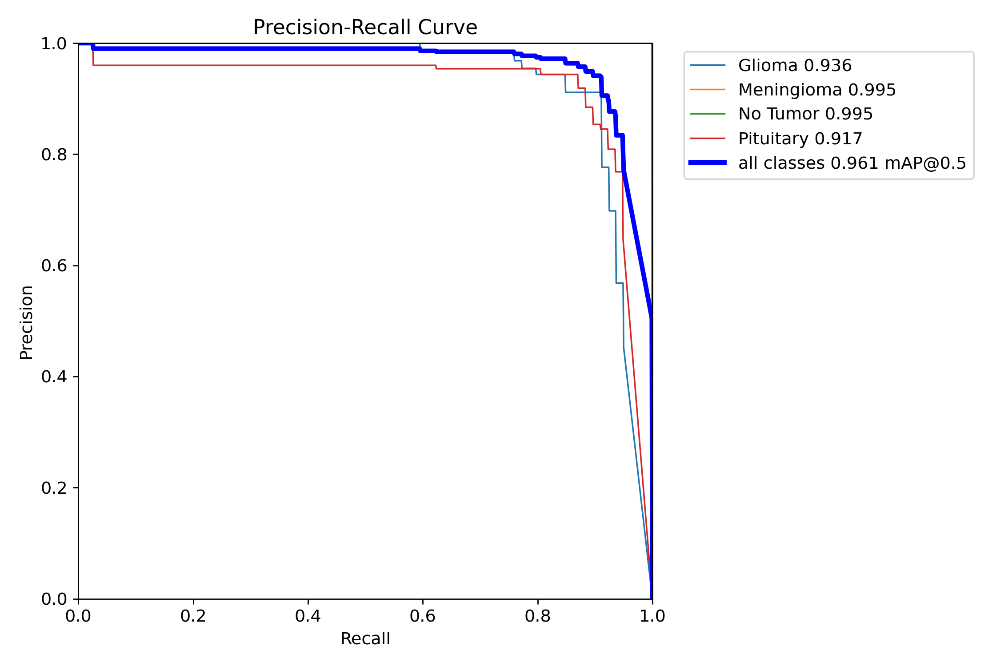 |


L'analyse ne se limite pas aux performances globales : les erreurs de classement, les faux positifs et les faux négatifs doivent également être examinés. **La catégorie `No Tumor` est une catégorie de données, et non un diagnostic clinique d'absence d'anomalie.**

Une synthèse d'autres entraînements figure dans [`results/meilleures_epoques_autres_experiences.csv`](results/meilleures_epoques_autres_experiences.csv). Les identifiants historiques de ces expériences ont été conservés ; ces résultats **ne constituent pas une comparaison contrôlée à budget d'époques identique**.

## 6. Organisation du dépôt

```
Brain_Tumor_Detection_yolo/
├── README.md
├── requirements.txt
├── .gitignore
├── notebooks/
│   ├── brain-tumor.ipynb
│   └── brain-tumor-yolov8l.ipynb
├── results/
│   └── meilleures_epoques_autres_experiences.csv
└── assets/
    ├── predictions/
    │   ├── yolov8x_exemples_irm.png
    │   └── yolo12l_exemples_irm.jpg
    ├── meilleures_epoques/
    │   ├── yolov8x_best_epoch.png
    │   └── yolo12l_best_epoch.png
    ├── courbes/
    │   ├── yolov8x_courbes_entrainement.png
    │   ├── yolo12l_courbes_entrainement.png
    │   ├── yolo12l_precision_rappel.png
    │   └── yolov8x_precision_rappel.png
    └── matrices/
        ├── yolov8x_matrice_confusion_normalisee.png
        └── yolo12l_matrice_confusion_normalisee.png

```
Les données IRM complètes, les poids `.pt`, les notebooks de test et les scripts de prétraitement **ne sont pas inclus** dans cette publication.

### Code source et notebooks d'entraînement

Les notebooks Jupyter développés dans le cadre de ce projet sont disponibles dans ce dépôt :

- **[Notebook d'entraînement — Version sans sorties d'exécution](notebooks/brain-tumor.ipynb)**
- **[Notebook d'entraînement — YOLOv8l avec résultats d'exécution](notebooks/brain-tumor-yolov8l.ipynb)**

D'autres notebooks, correspondant aux différentes architectures YOLO et configurations expérimentales étudiées, ont également été développés et conservés. Ils ne sont pas tous publiés dans ce dépôt, mais peuvent être mis à disposition sur demande.

## 7. Limites du projet et perspectives d'amélioration

Malgré les performances encourageantes obtenues par les différentes architectures YOLO, certaines limites doivent être prises en considération.

- **Taille limitée du jeu de données :** le dataset initial comprenait 5 249 images IRM. Après exclusion de trois images, 5 246 images ont été conservées. Ce volume reste relativement limité pour l'entraînement de modèles de Deep Learning, notamment pour apprendre à reconnaître toute la diversité des caractéristiques des tumeurs cérébrales.

- **Diversité et représentativité des données :** les images disponibles ne couvrent pas nécessairement toutes les variations anatomiques, les tailles et les formes des tumeurs, ni les différentes conditions d'acquisition des IRM. De plus, la répartition des images entre les quatre classes n'est pas parfaitement équilibrée, ce qui peut influencer les performances des modèles selon les catégories.

- **Capacité de généralisation :** les modèles ont été entraînés et évalués à partir de partitions issues d'un même jeu de données. Leurs performances sur des images provenant d'autres établissements hospitaliers, appareils IRM ou populations de patients restent à évaluer. Une validation sur des datasets externes et indépendants serait nécessaire pour mieux mesurer leur capacité de généralisation.

- **Sensibilité à la qualité des images :** les expérimentations ont montré que la qualité des IRM peut influencer les prédictions. Les images floues, bruitées ou présentant un faible contraste peuvent entraîner une diminution de la confiance des modèles, des erreurs de classification ou des tumeurs non détectées.

- **Perspectives d'amélioration :** les prochaines étapes pourraient inclure l'enrichissement du dataset avec des images plus diversifiées, l'amélioration des techniques d'augmentation de données, l'évaluation sur des bases externes et l'analyse approfondie des erreurs de détection, notamment des faux négatifs.

## 8. Informations académiques et références

**Projet tutoré de fin de Licence — Année universitaire 2024–2025**  
**Filière :** Sciences Mathématiques et Informatique (SMI)  
**Établissement :** Faculté des Sciences Dhar El Mahraz (FSDM)  
**Réalisé par :** Imane El Qoraychy et Amina El Moubtahij  
**Encadré par :** Pr. Hamid Tairi et Pr. Ilyasse Aboussaleh  
**Date de soutenance :** 26 mai 2025

**Références :**

- [Jeu de données — MRI for Brain Tumor with Bounding Boxes (Kaggle)](https://www.kaggle.com/datasets/ahmedsorour1/mri-for-brain-tumor-with-bounding-boxes)
- [Documentation officielle Ultralytics YOLO](https://docs.ultralytics.com/fr/)

---

**Avertissement :** ce projet est destiné à la recherche et à l'enseignement. Il ne constitue ni un avis médical, ni un outil clinique de diagnostic, de triage ou de traitement.
